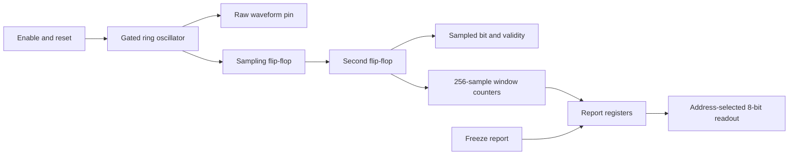

# Open silicon experiments

An open source ASIC toolchain for a first learning chip, targeting SKY130 and a
Tiny Tapeout fabrication budget below €500. The counter is a toolchain validation
design; the planned chip is an experimental physical random-number generator.

## Toolchain

The official LibreLane **3.0.14** Linux ARM64 container supplies Yosys, OpenROAD,
KLayout, Magic, Netgen, Verilator, Icarus Verilog and SymbiYosys. Both the container
digest and SKY130 process-kit revision are pinned in `toolchain.lock.json`.

On this Apple Silicon Mac, Colima **0.10.3** and Lima **2.2.1** provide the open
source Linux runtime. Their official binaries are checksum-verified and installed
under `.tools/`; no Homebrew installation or Xcode licence acceptance is required.
An existing Docker CLI is required. Docker Desktop is not required.

The named VM is `chip` and its Docker context is `colima-chip`. Colima/Lima keep VM
state in the user's normal `~/.colima` directories and downloads in the system's
user cache directories. The VM mounts this project for read/write access, uses
four CPUs, up to 8 GiB RAM and a sparse 40 GiB data disk. It does not change the
active Docker context. Each EDA container mounts only this project at `/work`.
Routine design builds run with container networking disabled; preparing the PDK
requires network access.

## Commands

From the project root:

```sh
# First installation on another Apple Silicon Mac:
python3 scripts/install-runtime.py

# Start the runtime and install the pinned tools/PDK:
python3 scripts/chip.py start
python3 scripts/chip.py prepare

# Validate the environment:
python3 scripts/chip.py verify

# Individual operations:
python3 scripts/chip.py versions
python3 scripts/chip.py rtl
python3 scripts/chip.py gds
python3 scripts/chip.py gates
python3 scripts/chip.py check
python3 scripts/chip.py tt-rtl  # Current entropy-probe RTL and deterministic tests
python3 scripts/chip.py tt      # Current entropy-probe physical flow and checks
python3 scripts/chip.py tool yosys -V
python3 scripts/chip.py tool openroad -version

# Release the VM's RAM when finished:
python3 scripts/chip.py stop
```

Downloads and generated files are ignored by Git. Preserve `toolchain.lock.json`,
the scripts and source designs to reproduce the setup. The runtime installer
requires Python 3.11+; this machine has Python 3.14.6.

## Verification design and outputs

`examples/counter/` contains an eight-bit counter with reset and enable, its
testbench and a physical implementation configuration. It exercises reset,
increment, wraparound, hold and restart in simulation. The pipeline also lints and
synthesizes it, then runs the LibreLane Classic flow through physical checks.
The same testbench also checks the final gate-level netlist with the SKY130 cell
models (functional simulation, without SDF timing annotation). The `check`
command verifies required metrics and logs for this historical counter design
and fails if evidence is missing. It is not the current entropy-probe check or
fabrication signoff. `verify` also includes this legacy counter check; use
`tt-rtl` for current probe RTL/test-mode checks or `tt` for its physical flow.

- Tool versions: `build/tool-versions.txt`
- RTL simulation: `build/rtl/test.log`
- Synthesis report: `build/rtl/synthesis.log`
- Gate-level simulation: `build/gates/test.log`
- Verification summary: `build/verification.md` and `build/verification.json`
- Physical implementation: `build/counter/runs/verified/`
- Final layout and other design views: `build/counter/runs/verified/final/`

The example is a standalone design macro. A Tiny Tapeout wrapper, exact shuttle
dimensions, pin constraints and submission prechecks are a later step. Passing
this example does not make it a complete packaged chip or a shuttle submission.

## Oscillator experiment and inspection

The first oscillator macro is implemented in `examples/ring-oscillator/`.
It is a gated five-inversion loop: one NAND and four inverters, with a separate
output buffer. Disabling it makes the output settle high. Enabling it creates
the physical feedback path. The output is an oscillator waveform, not random bits.


Three levels of inspection are available now:

| View | File / tool | What it shows |
| --- | --- | --- |
| Architecture | Diagram above and `examples/ring-oscillator/ring_oscillator.v` | Intended gates, ports and feedback |
| Configuration | `examples/ring-oscillator/config.json` and `constraints.sdc` | 100 × 100 µm macro, power grid, preservation and timing constraints |
| Synthesized circuit | `build/ring-oscillator/runs/verified/06-yosys-synthesis/ring_oscillator.nl.v` | Gates and connections retained by Yosys |
| Placed circuit | `build/oscillator-verification.json` | Checked connectivity, named cells and their actual coordinates in µm |
| Physical geometry | `build/oscillator-layout.png` and `build/oscillator-layout-detail.png` | KLayout renders of the actual GDS layers |
| Interactive physical inspection | `build/ring-oscillator/runs/verified/final/gds/ring_oscillator.gds` in KLayout | Zoom, cell hierarchy, layer visibility and distance measurement |

For interactive inspection, open the GDS in the open source KLayout desktop
application, load `.tools/pdk/sky130A/libs.tech/klayout/tech/sky130A.lyp` as the
layer properties, then expand the hierarchy. Toggle layers to separate diffusion,
polysilicon, contacts and metal wiring. Most visible repeated cells are filler
and well taps; the six functional cells occupy approximately x=48–56 µm,
y=41–49 µm. The detail PNG zooms to that area. The large grid in the full view
distributes power. This GDS is a standalone macro, not the full shuttle die.

Reproduce the oscillator milestone and images with:

```sh
python3 scripts/chip.py start
python3 scripts/chip.py oscillator
python3 scripts/chip.py tool openroad -exit -python /work/scripts/inspect-oscillator.py
python3 scripts/chip.py tool env QT_QPA_PLATFORM=offscreen klayout -z -r /work/scripts/render-layout.py
```

The connectivity checker compares every intended gate and signal connection in
both the synthesized JSON and final OpenROAD database. It also checks supply and
body-pin connections, placement, GDS existence and zero DRC/LVS/routing/antenna
errors. The 24 reviewed RTL lint warnings are the four omitted supply/body pins
on each explicit cell; the physical flow connects all of these pins. The timing
graph deliberately disables the NAND feedback arc while retaining its physical
wire. Static timing results therefore do not establish oscillator frequency.
The virtual reference clock is only a control-input constraint, not a real clock.
Logs also retain flow warnings about virtual-clock propagation, preserved I/O
cells, library reloading and macro power-source assumptions.

Architecture diagrams can be updated before each implementation. New physical
views become available after each synthesis/place/route run; we do not need to
wait for fabrication. The final chip view will follow integration of sampling,
diagnostics and the exact Tiny Tapeout wrapper and pin constraints.

## Sampling and diagnostics experiment

`examples/entropy-probe/` adds a clocked measurement block to the oscillator.
The architecture is now:



`clk` is the external sampling clock. `rst_n`, `enable`, `freeze_report` and
`addr[2:0]` must be driven synchronously to it. Reset is active low and synchronous
for the monitor; it also directly disables the oscillator. Keep reset low for at
least one rising edge. Enable starts acquisition after two clock edges of
pipeline warmup. The first valid sample is counted on the third edge.
There is no logic between the two sampling flip-flops, and the first stage drives
only the second. Two stages reduce metastability propagation risk; no silicon
failure-rate bound has been established.

The monitor counts **sampled** ones and changes in nonoverlapping 256-sample
windows. There are 255 comparisons within a window: its first bit is not compared
to the preceding window's last bit. Counts include the final sample. Ones use nine
bits so an all-one window correctly reports 256. These are sample statistics,
not a measurement of every oscillator edge or its frequency: aliasing and
correlation must be investigated by varying the sampling clock on silicon.

| Address | Readout |
| --- | --- |
| 0 | Status: bit 0 sample valid; bit 1 report ready; bit 2 enabled; bit 3 report frozen; bit 4 completed window had no transitions; bits 7:5 zero |
| 1 | Report generation, modulo 256 |
| 2 | Ones count, low eight bits |
| 3 | Ones count bit 8 in bit 0; other bits zero |
| 4 | Transition count, low eight bits |
| 5 | Transition count bit 8 in bit 0; other bits zero |
| 6 | Samples accumulated in the current window, modulo 256 |
| 7 | Interface version: 1 |

The dedicated outputs expose the unconditioned `sampled_bit`, `sample_valid`,
`report_ready`, and the buffered `raw_out` waveform. Capturing at rising clock
edges observes the same pre-edge sample that the monitor counts. `sampled_bit`
is forced low while invalid. No whitening, entropy extraction or PRNG is applied.

To read a coherent report, assert `freeze_report`, clock it in, then read
addresses 1–5. Reports and generation stay stable while frozen, but sampling and
window counters continue. Clear freeze to allow publication at the next completed
window. Disabling acquisition aborts the current partial window and flushes its
validity; the last completed report remains readable. Reset clears everything.
An unready report contains zero counts; the constant-window flag is qualified by
report readiness. A frozen report can remain old indefinitely, so readiness is
not a freshness or entropy guarantee. The constant-window flag is a diagnostic,
not a complete entropy-source health test.

Reproduce verification and the physical views:

```sh
python3 scripts/chip.py probe-rtl
python3 scripts/chip.py probe
python3 scripts/chip.py tool openroad -exit -python /work/scripts/inspect-probe.py
python3 scripts/chip.py tool env QT_QPA_PLATFORM=offscreen CHIP_VIEW=probe klayout -z -r /work/scripts/render-layout.py
```

- RTL and SKY130-mapped monitor simulations: `build/probe-rtl/test.log` and `gates.log`.
- Physical and connectivity evidence: `build/probe-verification.json`.
- Full layout / oscillator and synchronizer close-up: `build/probe-layout.png` and `build/probe-layout-detail.png`.
- Interactive layout: `build/entropy-probe/runs/verified/final/gds/entropy_probe.gds`.
- Physical netlist: `build/entropy-probe/runs/verified/final/nl/entropy_probe.nl.v`.

The testbench checks deterministic zero, one, alternating and periodic streams,
pipeline latency, every read register, window boundaries, freeze/resume, disable,
reset and generation wrap. Gate simulation covers the separately mapped monitor,
without SDF; it does not model oscillator noise or the complete routed design.
The physical checker verifies the ring connections, oscillator power/body pins,
direct sampling chain and single first-stage fanout in the final database. It
requires zero DRC/LVS/routing/antenna and electrical-limit errors and nonnegative
clocked setup/hold slack at all configured corners. The oscillator feedback arc
and paths originating at its asynchronous output are explicitly excluded from
static timing; the clocked monitor paths remain timed.

The earlier standalone example is a **120 × 120 µm macro**, with illustrative
pin positions. The integrated Tiny Tapeout design below supplies exact dimensions, pin mapping
and local submission checks; board validation remains outstanding. It has no pad storage or
cryptographic output guarantee.

References for the sampling and entropy-source distinctions:
[Intel synchronizer guidance](https://www.intel.com/content/www/us/en/docs/programmable/683068/18-1/metastability-analysis.html),
[NIST SP 800-90B](https://www.nist.gov/publications/recommendation-entropy-sources-used-random-bit-generation).

## Tiny Tapeout integration and board acquisition

The candidate is **TTSKY26d / SKY130**, targeting one digital tile. Upstream
template, support tools, SDK and GDS action commits are recorded in
`tinytapeout.lock.json`. The current GDS action uses the same LibreLane 3.0.14
as our toolchain. The pinned support-tool footprint is **161 × 111.52 µm**,
including fixed signal and power pin geometry from `tt_block_1x1_pg.def`.

`tinytapeout/src/tt_um_entropy_probe.v` implements the exact standard port
signature. The integrated revision uses `examples/resilient-probe/`: selectable 71-, 95- and
127-stage physical rings, one enabled at a time, a /1024 frequency output, and
zero/one/alternating/external-input test modes. A configuration change immediately
invalidates samples, aborts the partial window and restarts the two-edge warm-up.
Completed reports retain source/test configuration. Ring enables are three
registered one-hot flip-flops (`ring_run`), gated only by `ena` and `rst_n`, so
pin glitches between clock edges cannot stop or restart a ring. A ring starts one
edge after its selection is captured, and its monitor warm-up starts on that same
edge; ring-source windows therefore complete one clock later than test-mode
windows. A ring selection change leaves every ring off for at least one clock
period. Test-mode pins never stop a running ring, although changing them still
aborts the monitor's partial window. `ena` and `rst_n` stop the ring without a
clock edge. The register map is unchanged. The firmware helper pauses
acquisition and clocks the old and new requests separately during configuration;
direct source changes while enabled are not a qualified operating protocol.
This is interface **version 2**;
the earlier standalone monitor's version-1 table above remains historical.
Register 3 now contains the ninth ones-count bit at bit 0, test mode at bits 2:1,
and source at bits 4:3. Source 0/1/2 selects the three ring lengths; source 3
selects test mode 0/1/2/3 = zero/one/alternating/external bit.

Its externally visible pin map is:

| Pins | Role |
| --- | --- |
| `clk`, `rst_n` | Sampling clock and active-low reset |
| `ui_in[2:0]` | Register address |
| `ui_in[3]` | Acquisition enable |
| `ui_in[4]` | Freeze completed reports |
| `ui_in[5]` | Opt in to driving oscillator frequency /1024 |
| `ui_in[7:6]` | Source selection: 0/1/2 rings, 3 test mode |
| `uo_out[7:0]` | Register read data |
| `uio[0]` | Sampled bit, output |
| `uio[1]` | Sample valid, output |
| `uio[2]` | Report ready, output |
| `uio[3]` | Frequency /1024, output only when opted in |
| `uio[5:4]` | Test mode (input) |
| `uio[6]` | External test bit (input) |
| `uio[7]` | Unused input |

`ena` gates acquisition, all output data and output enables. An unselected project
does not drive any bidirectional pins. Upper `uio_out` bits are always zero.
Five intentionally unused input pins remain in the required interface; the checker
verifies that these exact pins, and no others, account for the disconnected-input
metric. There are zero critical disconnected pins. The wrapper test uses an
explicit deterministic oscillator stand-in; it does not simulate physical entropy.

The canonical monitor/oscillator sources remain under `examples/`. The staging
command copies them into `build/tinytapeout/src/`, alongside the wrapper, fixed DEF
and a configuration merged from the pinned official template. It mirrors the
official per-project merge, enables KLayout DRC, and adds our preservation and
asynchronous-source constraints. The staged directory is a local validation
bundle; author metadata, unique submission naming, submission documentation and
hosted shuttle CI still need completion before an order.

```sh
python3 scripts/chip.py tt-rtl
python3 scripts/chip.py tt
python3 scripts/chip.py tool openroad -python /work/scripts/inspect-tt.py
python3 scripts/tt-precheck.py
python3 scripts/chip.py tool env QT_QPA_PLATFORM=offscreen CHIP_VIEW=tt klayout -z -r /work/scripts/render-layout.py
python3 scripts/test-firmware.py
python3 scripts/chip.py tool bash /work/scripts/verify-resilient.sh
python3 scripts/chip.py tool bash /work/scripts/verify-physical.sh
python3 scripts/test-capture.py
python3 scripts/spice.py
```

The local precheck uses the **unmodified pinned official precheck sources**.
Python geometry checks run on macOS; Magic/KLayout subprocesses run inside our
Linux container through `scripts/tt-eda-proxy.py`. The Verilog syntax subprocess
uses native pinned Yosys instead of the upstream WebAssembly executable. The
host packages differ from the upstream Linux requirements because ARM Linux
gdstk wheels are unavailable. These local checks complement the shuttle's hosted
CI; they are not a claim that hosted CI or fabrication submission has completed.
On this Python 3.14 Apple Silicon host, install their pinned binary packages with:

```sh
python3 -m pip install --only-binary=:all: --target .tools/tt-host-python gdstk==1.0.1 klayout==0.30.8 PyYAML==6.0.3 numpy==2.4.2
```

Evidence and inspection views:

- `build/tt-rtl/test.log`: wrapper simulation, plus `ports.json` for signature checking.
- `build/tt-verification.json`: routed feedback/sampler connectivity and physical/timing checks.
- `build/tt-precheck/precheck/reports/results.xml`: all 15 local precheck cases passed.
- `build/tt-layout.png` and `build/tt-layout-detail.png`: actual one-tile GDS renders.
- `build/tinytapeout/src/runs/verified/final/gds/tt_um_entropy_probe.gds`: interactive KLayout view.

### Board bring-up

Use the appropriate Tiny Tapeout devkit for the purchased shuttle and its SDK.
The source-inspected SDK revision is pinned in the lock. Copy
`firmware/entropy_probe.py` to the board filesystem as `entropy_probe.py` after
silicon arrives. No board is currently attached, so the adapter has host tests
only; it has not been validated on real hardware. The staged, runnable procedure
for version/register reads, deterministic modes, PIO/DMA capture, abort and
cleanup is in [`firmware/BRINGUP.md`](firmware/BRINGUP.md).

If the ASIC is fabricated and its submitted project is included in that shuttle's
SDK index, the SDK project name is `tt_um_florianmodel_entropy_probe` (interface
version 2). The entry may not exist before those conditions are met. Hardware
validation remains open until board observations are recorded.

### Characterization plan

1. Confirm reset, interface version, enable/disable and report freezing on the
   delivered board. Verify the waveform and clock/data alignment with an analyzer.
2. Generate a continuous sampling clock. Initially use 100 kHz, 1 MHz and 5 MHz,
   then select further rates based on measured behavior. Capture `clk`, sample,
   validity and reset with an external logic analyzer or an RP2 PIO/DMA collector.
   Validate capture phase against propagation delay; use a settled clock phase,
   account for the pipeline offset, and compare a short capture with window counts.
3. Implement and validate fixed-rate capture before relying on long data files.
   Use chunked transfer without gaps in the captured clock stream. Mark buffer
   overflow or lost edges as a failed acquisition, not as missing random samples.
4. Collect at least one million consecutive unconditioned samples per chosen
   operating point, plus separate restart datasets. Save exact clock rate,
   acquisition method, reset history, chip/board identity, firmware/GDS hashes,
   voltage, temperature and the raw byte stream. This is an initial measurement
   target, not a complete NIST validation dataset specification.
5. Sweep sample rate and repeat across restarts and realistic supply/temperature
   conditions. Examine bias, periodicity, autocorrelation and predictors before
   selecting an entropy model. Do not mix captures from different conditions.
6. Use the existing NIST assessment tooling with justified assumptions; design
   online health tests and extraction only after defining the noise model and
   conservative entropy bounds. A balanced output alone does not imply entropy.

The chip now exposes oscillator frequency divided by 1024, rather than the
internal oscillator waveform. Enable it with UI5 to estimate ring frequency
from a much slower diagnostic signal. Timing assumes the internal ring remains
below 500 MHz; SPICE is model evidence for that assumption, not a silicon guarantee.
The 20 ns timing target verifies internal clocked logic, not the complete
board-to-chip capture path. The board uses 3.3 V I/O; core voltage experiments
require the board's supported supply-control method, not changing I/O voltage.

### Budget and schedule observation — 2026-10-05

The live SKY130 calculator showed a one-tile allocation of €70, a regular devkit
of €300 and economy shipping of €15: **€385**. Selecting individual pricing
reduced the devkit to €100, for **€185**, subject to limited discount availability.
Use the regular total for planning: this leaves €115 for acquisition accessories
and any extra checkout charges within the €500 cap. Tax treatment and final
checkout total have not been confirmed, and no order was placed. Defer buying
extra measurement hardware until the board/capture choice is confirmed.

The public schedule lists TTSKY26d with a November 30, 2026 submission deadline
and estimated June 9, 2027 shipping. Dates are estimates and must be rechecked
before committing to fabrication.

Sources: [current calculator](https://app.tinytapeout.com/calculator?pcbs=1&tiles=1),
[shuttle schedule](https://www.tinytapeout.com/chips/),
[SKY130 GPIO limits](https://tinytapeout.com/specs/gpio/),
[current devkit guide](https://tinytapeout.com/guides/get-started-demoboard-etr/),
[SDK source](https://github.com/TinyTapeout/tt-micropython-firmware),
[template](https://github.com/TinyTapeout/ttsky-verilog-template).

## Design iterations and confidence evidence

Numbered snapshots under `build/iterations/` preserve sources, final GDS and PNGs:

- `000-baseline`: the previous five-stage one-ring design.
- `001-short-rings-timing-failure`: 5/11/23 stages; digital features added, divider setup failed.
- `002-long-rings-electrical-failure`: 47/71/95 stages; setup passed, but routing caused slew/capacitance violations. An unloaded fast simulation also exceeded the 500 MHz ceiling.
- `003-compact-rings`: 71/95/127 stages in fixed two-row serpentine placement. Full physical checks pass, with setup 0.496 ns and hold 0.204 ns across configured timing corners.
- `007-automatic`: registered one-hot ring enables (2026-10-23). Full physical checks and all 15 local prechecks pass; nine-corner setup 0.511 ns and hold 0.205 ns. The complete routed transistor/RC matrix, including the 1 ns cut-control switch case, now passes.

`architecture.png` explains the logical design. `tt-layout.png`,
`tt-layout-detail.png` and individual `tt-layout-ring-N.png` files show real routed
geometry. `scripts/chip.py tt` now automatically renders and archives each completed physical
build, including failed signoff checks. `scripts/snapshot-iteration.py NAME`
refuses to overwrite an iteration. Rendering the architecture requires Pillow
(the current host has Pillow 12.3.0).
Use `scripts/render-architecture.py` and `scripts/render-layout.py` to update views.
The custom pinned Classic flow adds `scripts/compact-rings.py` before global
placement; hosted fabrication CI must include this step or use the approved
hardened artifact, rather than silently rerunning an unmodified flow.

Whole-chip functional gate simulation uses the actual routed netlist, with rings
disabled in deterministic test modes. It verifies reports, pin masking and a
4096-bit simulated capture passed through the PIO word decoder. It does not
simulate physical jitter or include SDF delays. Separate mapped-monitor regressions
exercise reset, freeze, partial-window aborts, 256-one counts and generation wrap.

`firmware/fixed_capture.py` implements a finite 16..32768-sample capture using PIO
and DMA at requested 1..100 kHz. One state machine generates the clock and reads
sample/valid before each rising edge. Blocking FIFO pushes prevent silent losses
but can stretch the clock if DMA stalls. Validate phase, achieved clock rate,
stalls and pin ownership on hardware; this is not yet a validated long entropy
capture. No board has been tested. `EntropyProbe.configure(source, test_mode,
external_bit)` drives only MCU pins 4..6 and preserves chip output pins as inputs.

The ngspice image is built with `docker --context colima-chip build -f
toolchain/spice.Dockerfile -t chip-ngspice:39 .`. `scripts/spice.py` runs deterministic
SKY130 transistor startup/frequency simulations with 5 fF lumped wire loads and
20 fF output load across TT/FF/SS, 1.6/1.8/1.95 V and -40/25/100 °C. All **81 loaded corner cases passed**, ranging from 27.0 to 167.1 MHz. Nine
unloaded fast cases passed, peaking at 390.9 MHz against the 500 MHz constraint.
Completed equivalent-circuit runs are cached; the slowest measurements use at
least three rising edges after 50 ns (some retained runs observe longer). These are schematic transistor simulations, not
extracted-layout RC or stochastic entropy validation. Model startup success does
not guarantee manufacturing yield or useful noise.

## Submission package and your remaining steps

The private repository is [florianmodel/chip-entropy-probe](https://github.com/florianmodel/chip-entropy-probe).
The submitted top is `tt_um_florianmodel_entropy_probe`; `florianmodel` is the
provisional author handle. Canonical development sources remain under
`examples/resilient-probe/` and `tinytapeout/`. `scripts/package-submission.py`
exports the checked layout, LEF and powered netlist, creates root `src/` and
`info.yaml`, and records source/artifact hashes in `submission/manifest.json`.
Only the GDS top-cell name changes; a geometry/hierarchy fingerprint verifies
that exporting preserves the physical design.

Hosted `gds` first rebuilds with the pinned container, PDK and compact-ring
placement, then verifies RTL, mapped logic, routed logic and capture decoding.
It runs Tiny Tapeout's pinned custom-GDS packaging and independent shuttle
precheck. `docs` generates the official PDF. The 2026-10-23 registered ring-enable
revision supersedes the earlier selection below; its exact SHA is selected only
after its hosted GDS and Docs workflows pass, and is recorded in a dated release
record. Until then, the previous verified fabrication revision is
**`5c18820752c6f92c0c089366977bce73828617c0`**.

- [GDS build, packaging and precheck](https://github.com/florianmodel/chip-entropy-probe/actions/runs/39663509277)
- [Official datasheet generation](https://github.com/florianmodel/chip-entropy-probe/actions/runs/39663509368)

The 2026-10-21 hosted release passed the fresh 90-case schematic sweep,
physical signoff, routed functional/capture checks, nine-corner timing review,
official custom-GDS packaging, official precheck and Docs generation. Its
geometry/hierarchy, placement and timing results match the locally reviewed
design. See the [release record](docs/release-2026-10-21.md) for exact hashes,
job links, evidence scope and archive details. Select the tested revision above,
rather than a later documentation-only commit.

Your remaining actions are:

1. Confirm the author handle and whether you want to publish this private
   repository. If the portal requires public access, authorize publication before
   changing visibility. Author/top-module changes require repackaging and checks.
2. Sign in to [Tiny Tapeout](https://app.tinytapeout.com/projects/create) using
   GitHub and create the project from the repository URL. Select the SKY130
   shuttle and one digital tile; the current candidate is TTSKY26d. Review the
   exact revision with successful GDS and Docs workflows before submission.
   Creating a project alone does not submit its fabrication revision.
3. Review a compatible development kit and the final checkout amount, including
   applicable taxes and shipping. Keep the entire project under €500. The
   regular calculator estimate is €385; individual pricing may be lower if
   available. No order has been placed. Avoid extra measurement purchases until
   the supplied board's capture is evaluated.
4. When the board arrives, connect it and run the documented deterministic
   bring-up tests with assistance. Validate clock/data phase and finite PIO/DMA
   capture on hardware before collecting oscillator data.

The source is still an experimental measurement chip. Model/physical/functional
checks improve confidence in the design but cannot guarantee manufacturing
yield or cryptographic entropy. Long gap-free acquisition, justified health
tests, noise modeling and entropy assessment remain later characterization work.

## References

The additional review repairs and routed transistor/RC experiment are documented
in [`docs/routed-verification.md`](docs/routed-verification.md). The independent
nine-corner timing command is `python3 scripts/timing-review.py`; the complete
partitioned clock/divider matrix is `python3 scripts/verify-routed-spice.py`.
Packaging labels unavailable or stale optional reports as unverified instead of
retaining an older committed PASS report. The fresh hosted release is recorded
separately in [the release record](docs/release-2026-10-21.md); local transistor
experiments remain distinct from the coverage regenerated by hosted CI.

- [LibreLane source and licence](https://github.com/librelane/librelane)
- [Tiny Tapeout local hardening](https://tinytapeout.com/guides/local-hardening/)
- [Tiny Tapeout flow versions](https://github.com/TinyTapeout/tt-gds-action/blob/main/action.yml)
- [Colima](https://github.com/abiosoft/colima)
- [Lima](https://github.com/lima-vm/lima)
- [OpenTRNG](https://opentrng.org/)
- [NIST entropy assessment](https://github.com/usnistgov/SP800-90B_EntropyAssessment)
